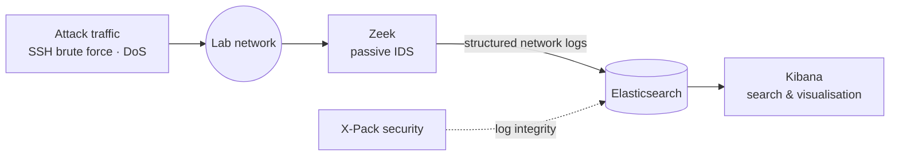

# SOC Lab — IDS ↔ SIEM correlation & forensic analysis

A small SOC pipeline that correlates a **passive network IDS (Zeek)** with a **SIEM (Elasticsearch + Kibana)**, used to investigate two attacks end to end: an **SSH brute force** and a **denial of service**.

| | |
|---|---|
| **Period** | February 2026 |
| **Type** | Detection & forensics lab |
| **Focus** | Network security monitoring · Log correlation · Incident analysis |

---

## Architecture

**Why this design?** Zeek observes traffic passively (it never sits in the data path) and turns raw packets into rich, structured logs. Sending those logs to a SIEM makes them searchable and lets the analyst correlate network evidence over time.

---

## What I did

- Deployed **Zeek** as a passive IDS to produce structured network logs from lab traffic.
- Indexed the Zeek logs in **Elasticsearch** and investigated them in **Kibana**.
- **Correlated** IDS and SIEM data to reconstruct two attacks.
- Protected **log integrity** with Elastic **X-Pack** security features, so the evidence used in the investigation can be trusted.

## Investigations

| Attack | Events analysed | ATT&CK |
|---|---:|---|
| SSH brute force | **592** | [T1110 — Brute Force](https://attack.mitre.org/techniques/T1110/) |
| Denial of service | **160,779** | [T1498 — Network Denial of Service](https://attack.mitre.org/techniques/T1498/) |

The volume gap between the two cases is the point of the exercise: a brute force is a few hundred events to piece together, while a DoS floods the pipeline with more than 160,000 events. In that volume, the right aggregations and visualisations are what make the analysis possible.

---

## Skills demonstrated

`Network security monitoring` · `IDS deployment` · `SIEM search & visualisation` · `Log correlation` · `Incident analysis` · `Evidence integrity`

## Tech stack

| Component | Role |
|---|---|
| Zeek | Passive network IDS, log generation |
| Elasticsearch | Log storage and search |
| Kibana | Investigation, queries and visualisation |
| X-Pack | Security features and log integrity |

---

Lab environment, no production data. Part of my cybersecurity portfolio — see my [GitHub profile](https://github.com/Emmanueltankam) · Emmanuel Tankam Talla
